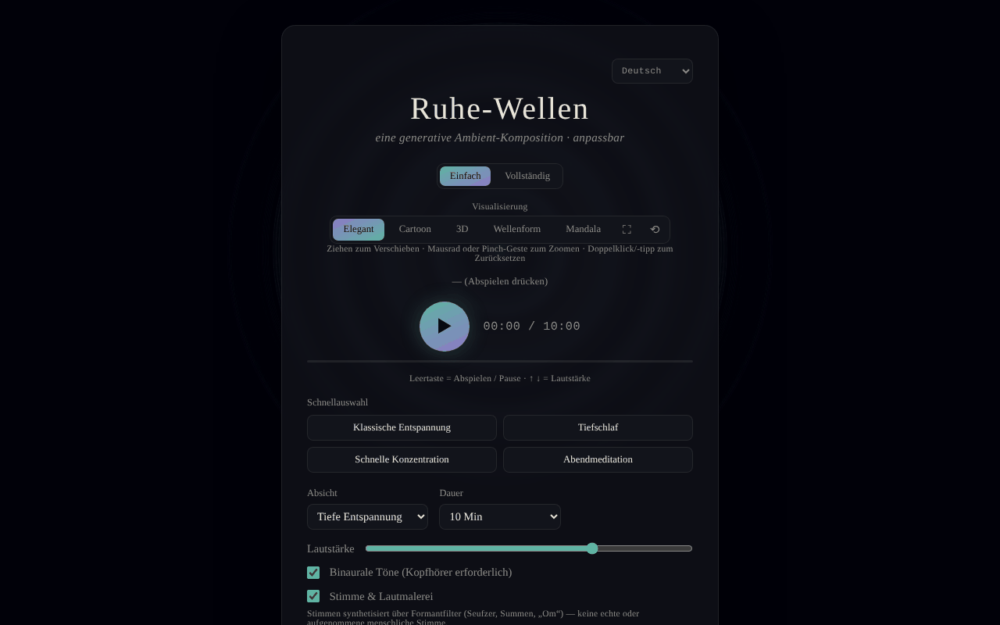

# Calm Waves

[English](README.md) · [Română](README.ro.md) · [Français](README.fr.md) · [Italiano](README.it.md) · [Español](README.es.md) · [Português](README.pt.md) · **Deutsch** · [Magyar](README.hu.md)

**Version:** 1.2.8 · **Zuletzt aktualisiert:** 2026-10-26

Oberflächensprachen: **Română, English, Français, Italiano, Español, Português (PT), Deutsch, Magyar**

Anpassbare generative Ambient-Komposition für Entspannung, Schlaf, Konzentration und Meditation.

**Online-App:** https://chiuta.github.io/CalmWaves/

## Was es ist

Calm Waves ist eine Single-File-Anwendung (`index.html`), die im Browser algorithmisch ruhige Ambient-Stücke erzeugt (Web Audio API). Du wählst Absicht, Klangpalette, Dichte, Dauer, Hintergrundtextur und Tempo, und die App erzeugt eine „Variante“, die über einen Code identifizierbar ist, den du kopieren und wieder laden kannst. Sie enthält animierte Visualisierungen und Audio-Export.

## Funktionen

- Zwei Modi: **Einfach** und **Vollständig** (letzterer zeigt die erweiterten Regler).
- Schnellvoreinstellungen (Klassische Entspannung, Tiefschlaf, Schneller Fokus, Abendmeditation) und eigene Voreinstellungen (höchstens 12, lokal gespeichert).
- Parameter: Absicht (Tiefe Entspannung, Schlaf, Ruhige Konzentration, Meditation), Klangpalette (Warm, Nächtlich, Ätherisch, Tief), Dichte (Minimal, Ausgewogen, Reich), Dauer (5–60 Min.), Hintergrundtextur (Neutral, Regen, Ozean, Wind), Tempo (Langsam, Natürlich, Aktiv).
- Binaurale Beats (Kopfhörer erforderlich), über Formantfilter synthetisierte Stimme (keine aufgenommene menschliche Stimme) mit Stimmprofilen, Gong zu Beginn und Muschelhorn am Ende (und manuelle Schaltflächen 🔔 / 🐚).
- Dauerwiedergabe (endlos neue Varianten) und automatisches Beenden (15–90 Min.) mit angezeigter Restzeit und allmählichem Absenken der Lautstärke in den letzten 20 s.
- Equalizer (Bass/Mitten/Höhen) und Stereobreite; Lautstärke.
- Variantencode: kopieren (📋), neue Variante (🔀), „Laden“, um einen Code abzuspielen; Verlauf der letzten Varianten.
- Visualisierungen: Elegant, Cartoon, 3D, Welle, Mandala; Vollbild, Ansicht zurücksetzen, Verschieben/Zoomen mit Maus oder Touch.
- Export: WAV, AIFF und „Komprimiert exportieren“ (WebM/Ogg/M4A, je nach Browserunterstützung, über MediaRecorder).
- Hält den Bildschirm während der Wiedergabe aktiv, sofern der Browser Wake Lock unterstützt.
- Oberfläche in 8 Sprachen: English, Română, Français, Italiano, Español, Português, Deutsch, Magyar.
- Erläuternde Abschnitte: „Wie es funktioniert, technisch“ und „Was die Forschung tatsächlich sagt“.

## Neu (v1.1.0)

- **QR-Code für die Variante**: Aus „Variantencode“ wird ein QR erzeugt (mit Webadresse und `?v=Code`, oder nur der Code, wenn keine Adresse vorhanden ist); „QR-Bild lesen“ lädt die Variante; ein ungültiger Code oder ein Bild ohne QR ergibt eine Meldung, ohne Änderungen.
- **Kurze Sprachführung** (Opt-in, standardmäßig aus, `FFF.tts`): spricht zu Beginn die gewählte Absicht und am Ende eine kurze Nachricht; das Beenden der Sitzung schneidet die Stimme ab; ohne Stimme in der Sprache der Oberfläche oder ohne Sprachsynthese erscheint eine klare Meldung, und es wird nichts gesprochen.
- **Konfigurierbares Ausblenden beim automatischen Beenden** (standardmäßig 20 s, 1 Min., 5 Min.): Die Lautstärke sinkt nur im gewählten Intervall, in den Tests in Echtzeit geprüft.
- **Kit**: Transparenz und `.fff.json`-Sicherung (die Stimmpräferenz wird indiziert), `core, label, bundle, qr, tts`.
- **Sprachen und Übersetzungen**: Die neuen Texte liegen in den 8 Sprachen der App vor (RO, EN, FR, IT, ES, PT, DE, HU). Die Übersetzungen FR/IT/ES/PT/DE/HU sind automatisch und **nicht von Muttersprachlern geprüft**; der Dialog des Kits hat 8 Sprachen.

## Anleitung

1. Wähle die Sprache im Sprachauswahlfeld in der Kopfzeile.
2. Wähle den Modus **Einfach** oder **Vollständig**.
3. Wähle eine Schnellvoreinstellung oder stelle Absicht, Palette, Dichte, Dauer, Textur und Tempo manuell ein.
4. Drücke ▶ (Anhören), um zu starten. Tasten: **Leertaste** = Wiedergabe/Pause, **↑ / ↓** = Lautstärke (±5). Die Tasten wirken nicht, wenn der Fokus auf einem Feld, einer Schaltfläche oder einer Liste liegt.
5. Wechsle die Visualisierung (Elegant / Cartoon / 3D / Welle / Mandala); ziehen zum Verschieben, Scrollen oder Pinch zum Zoomen, Doppelklick zum Zurücksetzen.
6. Um ein Stück wiederherzustellen: kopiere den „Variantencode“ (📋), füge ihn später ein und drücke „Laden“. 🔀 erzeugt eine neue Variante.
7. Für eine eigene Voreinstellung (Modus Vollständig): gib einen Namen in „Name der neuen Voreinstellung“ ein und drücke „+ Aktuelle Voreinstellung hinzufügen“ (oder Enter).
8. Stelle das „Automatische Beenden“ ein, wenn du beim Einschlafen hörst.
9. Export: „Als WAV exportieren“, „AIFF“ oder „Komprimiert exportieren“ (mit „Abbrechen“ zum Stoppen).

## Datenschutz und Netzwerk

- Das „Trade-free“-Kit (`fff-kit`, Module `core, label, bundle, qr, tts`) ist in `index.html` eingebettet: Es stellt keine Netzwerkanfragen. Der Dialog „Transparenz“ (Klick auf die Version) zeigt das deklarierte Netzwerk (0 externe Anfragen), die Schlüssel in `localStorage`, den SHA-256 der Datei und bietet eine `.fff.json`-Sicherung (optional mit Passwort verschlüsselt, AES-GCM). QR-Codes werden lokal erzeugt und gelesen; das Lesen erfolgt nur aus einem vom Nutzer gewählten Bild, ohne Kamera.

- **Lokaler Speicher:** nur die eigenen Voreinstellungen, in `localStorage` (Schlüssel `calmWavesCustomPresets`). Im Code habe ich keine weiteren persistenten Schlüssel gefunden.
- **Netzwerk:** Der Code macht keine `fetch`-/XHR-Aufrufe und lädt keine externen Skripte, Schriften oder Ressourcen; Audio und Grafik werden lokal erzeugt. Die einzigen externen Adressen sind Navigationslinks, die per Klick geöffnet werden: trade-free.org, Buy Me a Coffee (die Schaltfläche ♥).
- Die Fußzeile der App erklärt: MIT, trade-free, 100 % offline, keine Telemetrie.

## Einschränkungen und Haftungsausschluss

Informations- und Entspannungsinhalt; kein Medizinprodukt und kein Ersatz für ärztlichen Rat oder Behandlung. Der Abschnitt „Was die Forschung tatsächlich sagt“ fasst Aussagen über Studien zusammen (z. B. binaurale Beats und Angst), die nicht unabhängig überprüft wurden (am 11.10.2026 blieb die Überprüfung per Websuche ohne Ergebnis; die App zeigt jetzt in allen 8 Sprachen einen entsprechenden Hinweis) und nicht als therapeutisches Versprechen verstanden werden dürfen. Wer an Epilepsie oder neurologischen Erkrankungen leidet, sollte vor der Nutzung binauraler Beats ärztlichen Rat einholen. Die Seite hat jetzt eine strikte Content-Security-Policy (`default-src 'none'`, keine externen Verbindungen).

Ein kurzer Hinweis (RO/EN) wird unter der Fußzeile der App angezeigt.

## Lokal / offline ausführen

Lade `index.html` herunter und öffne sie in einem Browser; kein Internet erforderlich. Einige Funktionen hängen vom Browser ab (Wake Lock, MediaRecorder für den komprimierten Export).

## Lizenz

MIT — siehe die Datei LICENSE.

## Audit

Audit: 2026-10-10 — Die Aussagen „kein Netzwerk / keine Telemetrie“ stimmen mit dem Code überein (kein `fetch`/XHR/CDN).

## Autor

Alexio — Alexandru-Ionuț Chiuță, Kontakt: alexio@trom.tf.

## Zusammenfassung

Calm Waves ist eine generative Ambient-Musik-App in einer einzigen Datei (Web Audio API) mit Reglern für Absicht, Palette, Dichte, Dauer, Textur und Tempo, binauralen Tönen, synthetisierten Formantstimmen, teilbaren Variantencodes, fünf Visualisierungen und Export als WAV/AIFF/komprimiert. 8 Oberflächensprachen. Nur eigene Voreinstellungen werden in localStorage gespeichert; keine Netzwerkanfragen außer optionalen ausgehenden Links. MIT-Lizenz.

## Verlauf / Changelog

- 1.2.7 — 2026-10-23: i18n-Parität geprüft: der Schlüssel `sevaLink` existiert in allen 8 Sprachen (zur Laufzeit ergänzt), als Ausnahme in `fff.config.json` dokumentiert (fff-kit-1.2.0-Prüfung)
- 1.2.5 — 2026-10-22: fff-kit 1.1.4: Touch-Ziele und Mindestschriftgröße
- 1.2.4 — 2026-10-22: fff-kit 1.1.2: PBKDF2 mit 600.000 Iterationen, Schutz vor Clickjacking
- 1.2.3 — 2026-10-22: Feinschliff für Mobilgeräte und Barrierefreiheit: Text mit mindestens 12 px und Touch-Ziele von mindestens 24 px.
- **1.2.2 — 2026-10-22:** das Barrierefreiheits-Label des Feldes für den Code der aktuellen Variante ist jetzt in alle Sprachen übersetzt (es war rumänisch geblieben).
- 1.2.1 — 2026-10-22: **Korrektur**: der statische medizinische Hinweis, die ARIA-Beschriftungen und Tooltips sind jetzt in alle Sprachen übersetzt; ungarische Oberflächentexte ergänzt (Sprachführung, QR, SEVA-Link).
- 1.1.1 — 2026-10-19: **Korrektur**: Der Parameter `?v=<Variantencode>` in der Adresse wird beim Laden nicht mehr von der Standardvariante überschrieben (die Meldung „Variante geladen“ war falsch); informativer Link zu SEVA (Schlaf, Entspannung, Meditation).
- 1.1.0 — 2026-10-14: QR-Code für die Variante, Sprachführung, konfigurierbares Ausblenden, „Trade-free“-Kit. Tests: `tests/fff-r8.test.mjs`.

### 12. Oktober 2026 (v1.0.0)
- 1.0.0 — 2026-10-12: Die Version und das Datum der letzten Aktualisierung werden in der App angezeigt

### 11. Oktober 2026
- Der Export zeigt während des Renderns den Fortschritt (Prozent); die Endung in der Abschlussmeldung entspricht dem gewählten Format. Startet das Audio nicht (angehaltener Kontext), erscheint nach ~2,5 s ein sichtbarer Hinweis (7 Sprachen).
- Das automatische Beenden zeigt die Restzeit (7 Sprachen) und senkt die Lautstärke in den letzten 20 s allmählich, statt abrupt zu stoppen. CSP: `script-src` per SHA-256-Hash, ohne `'unsafe-inline'` für Skripte.
- Eine restriktive Content-Security-Policy (Meta) hinzugefügt; WAV-/AIFF-Export und Wiedergabe unter CSP geprüft.
- Der Abschnitt „Was die Forschung sagt“ enthält einen ausdrücklichen Hinweis (7 Sprachen), dass die Zusammenfassung nicht unabhängig erneut überprüft wurde.
- axe-Prüfungen (1280 und 360 px): 0 Verstöße; kein horizontaler Überlauf.

Am 11.10.2026 geprüfte Quellen: Die Websuche nach Metaanalysen zu binauralen Beats und zu Ultraschall-Abwehrgeräten ergab keine schlüssigen Bestätigungen, deshalb bleiben die Aussagen als ungeprüft gekennzeichnet
