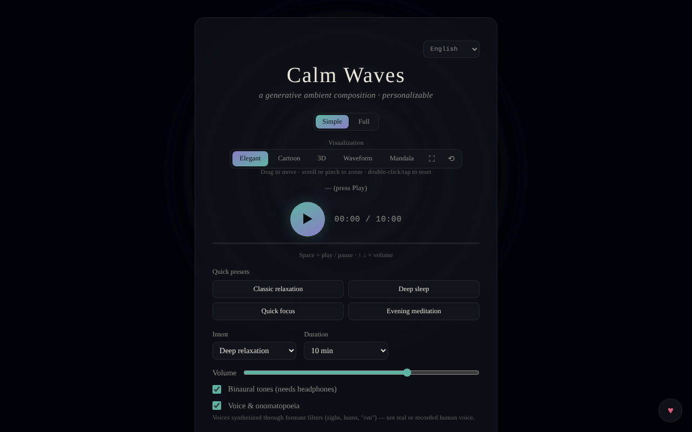

# Calm Waves

[English](README.md) · [Română](README.ro.md) · [Français](README.fr.md) · [Italiano](README.it.md) · **Español** · [Português](README.pt.md) · [Deutsch](README.de.md) · [Magyar](README.hu.md)

**Versión:** 1.2.0 · **Última actualización:** 2026-10-19

Idiomas de la interfaz: **Română, English, Français, Italiano, Español, Português (PT), Deutsch, Magyar**

Composición ambiental generativa personalizable para la relajación, el sueño, la concentración y la meditación.

**Aplicación en línea:** https://chiuta.github.io/CalmWaves/

## Qué es

Calm Waves es una aplicación de un único archivo (`index.html`) que genera algorítmicamente, en el navegador, piezas ambientales tranquilas (Web Audio API). Eliges la intención, la paleta tonal, la densidad, la duración, la textura de fondo y el ritmo, y la aplicación genera una «variante» identificable mediante un código que puedes copiar y volver a cargar. Incluye visualizaciones animadas y exportación de audio.

## Funciones

- Dos modos: **Simple** y **Completo** (este último muestra los controles avanzados).
- Preajustes rápidos (Relajación clásica, Sueño profundo, Concentración rápida, Meditación vespertina) y preajustes personalizados (máximo 12, guardados localmente).
- Parámetros: intención (Relajación profunda, Sueño, Concentración tranquila, Meditación), paleta tonal (Cálida, Nocturna, Etérea, Profunda), densidad (Mínima, Equilibrada, Rica), duración (5–60 min), textura de fondo (Neutra, Lluvia, Océano, Viento), ritmo (Lento, Natural, Activo).
- Ondas binaurales (requieren auriculares), voz sintetizada mediante filtros de formantes (no una voz humana grabada) con perfiles de voz, gong al principio y caracola al final (y botones manuales 🔔 / 🐚).
- Reproducción continua (variantes nuevas sin fin) y apagado automático (15–90 min) con el tiempo restante visible y bajada gradual del volumen durante los últimos 20 s.
- Ecualizador (graves/medios/agudos) y anchura estéreo; volumen.
- Código de variante: copiar (📋), variante nueva (🔀), «Cargar» para reproducir un código; historial de variantes recientes.
- Visualizaciones: Elegante, Cartoon, 3D, Onda, Mandala; pantalla completa, restablecer la vista, desplazamiento/zoom con ratón o con el tacto.
- Exportación: WAV, AIFF y «Exportar comprimido» (WebM/Ogg/M4A, según lo que admita el navegador, mediante MediaRecorder).
- Mantiene la pantalla activa durante la reproducción, si el navegador admite Wake Lock.
- Interfaz en 8 idiomas: English, Română, Français, Italiano, Español, Português, Deutsch, Magyar.
- Secciones explicativas: «Cómo funciona, técnicamente» y «Qué dice realmente la investigación».

## Novedades (v1.1.0)

- **Código QR de la variante**: desde «Código de variante» se genera un QR (con dirección web y `?v=código`, o solo el código si no hay dirección); «Leer imagen QR» carga la variante; un código no válido o una imagen sin QR muestra un mensaje, sin modificar nada.
- **Guía de voz breve** (opcional, desactivada por defecto, `FFF.tts`): pronuncia al principio la intención elegida y un mensaje corto al final; detener la sesión corta la voz; sin voz en el idioma de la interfaz o sin síntesis de voz aparece un mensaje claro y no se pronuncia nada.
- **Fundido configurable en el apagado automático** (20 s por defecto, 1 min, 5 min): el volumen baja solo en el intervalo elegido, comprobado en tiempo real en las pruebas.
- **Kit**: Transparencia y copia de seguridad `.fff.json` (la preferencia de voz se indexa), `core, label, bundle, qr, tts`.
- **Idiomas y traducciones**: los textos nuevos están en los 8 idiomas de la aplicación (RO, EN, FR, IT, ES, PT, DE, HU). Las traducciones FR/IT/ES/PT/DE/HU son automáticas y **no han sido verificadas por hablantes nativos**; el diálogo del kit tiene 8 idiomas.

## Guía de uso

1. Elige el idioma en el selector de idioma de la cabecera.
2. Elige el modo **Simple** o **Completo**.
3. Elige un preajuste rápido o configura manualmente la intención, la paleta, la densidad, la duración, la textura y el ritmo.
4. Pulsa ▶ (Escuchar) para empezar. Teclas: **Espacio** = reproducir/pausa, **↑ / ↓** = volumen (±5). Las teclas no actúan cuando el foco está en un campo, un botón o una lista.
5. Cambia la visualización (Elegante / Cartoon / 3D / Onda / Mandala); arrastra para mover, rueda o pellizco para el zoom, doble clic para restablecer.
6. Para rehacer una pieza: copia el «Código de variante» (📋) y más tarde pégalo y pulsa «Cargar». 🔀 genera una variante nueva.
7. Para un preajuste propio (modo Completo): escribe un nombre en «Nombre del nuevo preajuste» y pulsa «+ Añadir el preajuste actual» (o Intro).
8. Configura el «Apagado automático» si escuchas al acostarte.
9. Exportación: «Exportar como WAV», «AIFF» o «Exportar comprimido» (con «Cancelar» para detener).

## Privacidad y red

- El kit «sin fronteras» (`fff-kit`, módulos `core, label, bundle, qr, tts`) está integrado en `index.html`: no realiza solicitudes de red. El diálogo «Transparencia» (clic en la versión) muestra la red declarada (0 solicitudes externas), las claves de `localStorage`, el SHA-256 del archivo y ofrece una copia de seguridad `.fff.json` (opcionalmente cifrada con contraseña, AES-GCM). Los códigos QR se generan y se leen localmente; la lectura se hace solo desde una imagen elegida por el usuario, sin cámara.

- **Almacenamiento local:** solo los preajustes personalizados, en `localStorage` (clave `calmWavesCustomPresets`). No he encontrado otras claves persistentes en el código.
- **Red:** el código no realiza llamadas `fetch`/XHR y no carga scripts, fuentes ni recursos externos; el audio y los gráficos se generan localmente. Las únicas direcciones externas son enlaces de navegación que se abren al hacer clic: trade-free.org, Buy Me a Coffee (el botón ♥).
- El pie de la aplicación declara: MIT, trade-free, 100 % sin conexión, sin telemetría.

## Limitaciones y descargo de responsabilidad

Contenido informativo y de relajación; no es un producto sanitario y no sustituye el consejo médico ni el tratamiento. La sección «Qué dice realmente la investigación» resume afirmaciones sobre estudios (p. ej., ondas binaurales y ansiedad) que no han sido verificadas de forma independiente (a 11.10.2026 la verificación mediante búsqueda web quedó sin conclusión; la aplicación muestra ahora una nota en este sentido, en los 8 idiomas) y no deben tomarse como una promesa terapéutica. Quien tenga epilepsia o afecciones neurológicas debería consultar a un médico antes de usar ondas binaurales. La página tiene ahora una Content-Security-Policy estricta (`default-src 'none'`, sin conexiones externas).

Se muestra una nota breve (RO/EN) debajo del pie de la aplicación.

## Ejecución local / sin conexión

Descarga `index.html` y ábrelo en un navegador; no requiere internet. Algunas funciones dependen del navegador (Wake Lock, MediaRecorder para la exportación comprimida).

## Licencia

MIT — véase el archivo LICENSE.

## Auditoría

Auditoría: 2026-10-10 — las afirmaciones «sin red / sin telemetría» coinciden con el código (sin `fetch`/XHR/CDN).

## Autor

Alexio — Alexandru-Ionuț Chiuță, contacto: alexio@trom.tf.

## English summary

Calm Waves is a single-file generative ambient music app (Web Audio API) with intent, palette, density, duration, texture and pace controls, binaural tones, synthesized formant voices, shareable variant codes, five visualizations and WAV/AIFF/compressed export. 8 UI languages. Only custom presets are stored in localStorage; no network requests apart from optional outbound links. MIT license.

## Historial / Changelog

- 1.1.1 — 2026-10-19: **corrección**: el parámetro `?v=<código de variante>` de la dirección ya no es sobrescrito por la variante por defecto al cargar (el mensaje «Variante cargada» era falso); enlace informativo a SEVA (sueño, relajación, meditación).
- 1.1.0 — 2026-10-14: código QR de la variante, guía de voz, fundido configurable, kit «sin fronteras». Pruebas: `tests/fff-r8.test.mjs`.

### 12 de octubre de 2026 (v1.0.0)
- 1.0.0 — 2026-10-12: la versión y la fecha de la última actualización se muestran en la aplicación

### 11 de octubre de 2026
- La exportación muestra el progreso (porcentaje) durante el renderizado; la extensión del mensaje final corresponde al formato elegido. Si el audio no arranca (contexto suspendido), aparece una nota visible (7 idiomas) tras ~2,5 s.
- El apagado automático muestra el tiempo restante (7 idiomas) y baja el volumen gradualmente durante los últimos 20 s, en lugar de detenerse bruscamente. CSP: `script-src` con hash SHA-256, sin `'unsafe-inline'` para los scripts.
- Añadida una Content-Security-Policy (meta) restrictiva; exportación WAV/AIFF y reproducción verificadas bajo CSP.
- La sección «Qué dice la investigación» tiene una nota explícita (7 idiomas) de que el resumen no se ha vuelto a verificar de forma independiente.
- Comprobaciones axe (1280 y 360 px): 0 infracciones; sin desbordamiento horizontal.

Fuentes comprobadas a 11.10.2026: la búsqueda web de metaanálisis sobre ondas binaurales y sobre repelentes de ultrasonidos no dio confirmaciones concluyentes, por lo que las afirmaciones siguen marcadas como no verificadas
