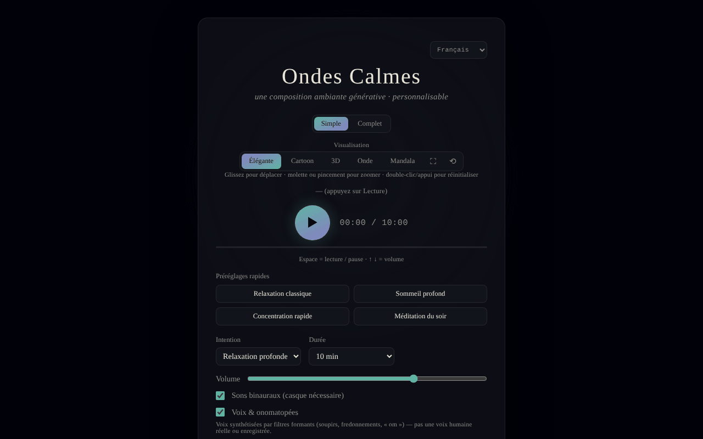

# Calm Waves

[English](README.md) · [Română](README.ro.md) · **Français** · [Italiano](README.it.md) · [Español](README.es.md) · [Português](README.pt.md) · [Deutsch](README.de.md) · [Magyar](README.hu.md)

**Version :** 1.2.4 · **Dernière mise à jour :** 2026-10-22

Langues de l'interface : **Română, English, Français, Italiano, Español, Português (PT), Deutsch, Magyar**

Composition ambiante générative personnalisable pour la détente, le sommeil, la concentration et la méditation.

**Application en ligne :** https://chiuta.github.io/CalmWaves/

## De quoi s'agit-il

Calm Waves est une application en un seul fichier (`index.html`) qui génère algorithmiquement, dans le navigateur, des pièces ambiantes apaisantes (Web Audio API). Vous choisissez l'intention, la palette tonale, la densité, la durée, la texture de fond et le rythme, et l'application génère une « variante » identifiable par un code que vous pouvez copier et recharger. Elle comprend des visualisations animées et l'export audio.

## Fonctionnalités

- Deux modes : **Simple** et **Complet** (ce dernier affiche les commandes avancées).
- Préréglages rapides (Détente classique, Sommeil profond, Concentration rapide, Méditation du soir) et préréglages personnalisés (12 au maximum, enregistrés localement).
- Paramètres : intention (Détente profonde, Sommeil, Concentration calme, Méditation), palette tonale (Chaude, Nocturne, Éthérée, Profonde), densité (Minimale, Équilibrée, Riche), durée (5–60 min), texture de fond (Neutre, Pluie, Océan, Vent), rythme (Lent, Naturel, Actif).
- Battements binauraux (casque nécessaire), voix synthétisée par filtres de formants (pas une voix humaine enregistrée) avec des profils de voix, gong au début et conque à la fin (et boutons manuels 🔔 / 🐚).
- Lecture continue (de nouvelles variantes à l'infini) et arrêt automatique (15–90 min) avec affichage du temps restant et baisse progressive du volume pendant les 20 dernières secondes.
- Égaliseur (graves/médiums/aigus) et largeur stéréo ; volume.
- Code de variante : copie (📋), nouvelle variante (🔀), « Charger » pour lire un code ; historique des variantes récentes.
- Visualisations : Élégante, Cartoon, 3D, Onde, Mandala ; plein écran, réinitialisation de la vue, déplacement/zoom à la souris ou au toucher.
- Export : WAV, AIFF et « Exporter compressé » (WebM/Ogg/M4A, selon ce que prend en charge le navigateur, via MediaRecorder).
- Maintient l'écran allumé pendant la lecture, si le navigateur prend en charge Wake Lock.
- Interface en 8 langues : English, Română, Français, Italiano, Español, Português, Deutsch, Magyar.
- Sections explicatives : « Comment ça marche, techniquement » et « Ce que dit réellement la recherche ».

## Nouveautés (v1.1.0)

- **Code QR de la variante** : depuis « Code de variante », un QR est généré (avec une adresse web et `?v=code`, ou seulement le code s'il n'y a pas d'adresse) ; « Lire une image QR » charge la variante ; un code invalide ou une image sans QR donne un message, sans aucune modification.
- **Guidage vocal bref** (sur option, désactivé par défaut, `FFF.tts`) : énonce au début l'intention choisie et un court message à la fin ; l'arrêt de la session coupe la voix ; sans voix dans la langue de l'interface ou sans synthèse vocale, un message clair apparaît et rien n'est prononcé.
- **Fondu configurable à l'arrêt automatique** (20 s par défaut, 1 min, 5 min) : le volume ne baisse que dans l'intervalle choisi, vérifié en temps réel dans les tests.
- **Kit** : Transparence et sauvegarde `.fff.json` (la préférence de voix est indexée), `core, label, bundle, qr, tts`.
- **Langues et traductions** : les nouveaux textes sont dans les 8 langues de l'application (RO, EN, FR, IT, ES, PT, DE, HU). Les traductions FR/IT/ES/PT/DE/HU sont automatiques et **non vérifiées par des locuteurs natifs** ; la boîte de dialogue du kit existe en 8 langues.

## Mode d'emploi

1. Choisissez la langue dans le sélecteur de langue de l'en-tête.
2. Choisissez le mode **Simple** ou **Complet**.
3. Choisissez un préréglage rapide ou réglez manuellement l'intention, la palette, la densité, la durée, la texture et le rythme.
4. Appuyez sur ▶ (Écouter) pour démarrer. Touches : **Espace** = lecture/pause, **↑ / ↓** = volume (±5). Les touches n'agissent pas lorsque le focus est sur un champ, un bouton ou une liste.
5. Changez la visualisation (Élégante / Cartoon / 3D / Onde / Mandala) ; faites glisser pour déplacer, molette ou pincement pour zoomer, double-clic pour réinitialiser.
6. Pour retrouver une pièce : copiez le « Code de variante » (📋), puis, plus tard, collez-le et appuyez sur « Charger ». 🔀 génère une nouvelle variante.
7. Pour un préréglage personnel (mode Complet) : saisissez un nom dans « Nom du nouveau préréglage » et appuyez sur « + Ajouter le préréglage actuel » (ou Entrée).
8. Réglez l'« Arrêt automatique » si vous écoutez au coucher.
9. Export : « Exporter en WAV », « AIFF » ou « Exporter compressé » (avec « Annuler » pour arrêter).

## Confidentialité et réseau

- Le kit « sans frontières » (`fff-kit`, modules `core, label, bundle, qr, tts`) est intégré dans `index.html` : il ne fait aucune requête réseau. La boîte de dialogue « Transparence » (clic sur la version) montre le réseau déclaré (0 requête externe), les clés de `localStorage`, le SHA-256 du fichier et propose une sauvegarde `.fff.json` (éventuellement chiffrée par mot de passe, AES-GCM). Les codes QR sont générés et lus localement ; la lecture se fait uniquement à partir d'une image choisie par l'utilisateur, sans caméra.

- **Stockage local :** uniquement les préréglages personnalisés, dans `localStorage` (clé `calmWavesCustomPresets`). Je n'ai trouvé aucune autre clé persistante dans le code.
- **Réseau :** le code ne fait aucun appel `fetch`/XHR et ne charge ni scripts, ni polices, ni ressources externes ; l'audio et les graphiques sont générés localement. Les seules adresses externes sont des liens de navigation ouverts au clic : trade-free.org, Buy Me a Coffee (le bouton ♥).
- Le pied de page de l'application déclare : MIT, trade-free, 100 % hors ligne, sans télémétrie.

## Limites et avertissement

Contenu informatif et de détente ; ce n'est pas un dispositif médical et ne remplace ni un avis médical ni un traitement. La section « Ce que dit réellement la recherche » résume des affirmations sur des études (p. ex. battements binauraux et anxiété) qui n'ont pas été vérifiées de manière indépendante (au 11.10.2026, la vérification par recherche web est restée peu concluante ; l'application affiche désormais une note en ce sens, dans les 8 langues) et ne doit pas être prise comme une promesse thérapeutique. Les personnes épileptiques ou atteintes d'affections neurologiques devraient demander l'avis d'un médecin avant d'utiliser des battements binauraux. La page dispose désormais d'une Content-Security-Policy stricte (`default-src 'none'`, sans connexions externes).

Une courte note (RO/EN) est affichée sous le pied de page de l'application.

## Exécution locale / hors ligne

Téléchargez `index.html` et ouvrez-le dans un navigateur ; aucun accès à Internet n'est nécessaire. Certaines fonctions dépendent du navigateur (Wake Lock, MediaRecorder pour l'export compressé).

## Licence

MIT — voir le fichier LICENSE.

## Audit

Audit : 2026-10-10 — les affirmations « sans réseau / sans télémétrie » correspondent au code (pas de `fetch`/XHR/CDN).

## Auteur

Alexio — Alexandru-Ionuț Chiuță, contact : alexio@trom.tf.

## Résumé

Calm Waves est une application de musique ambiante générative en un seul fichier (Web Audio API), avec des commandes d'intention, de palette, de densité, de durée, de texture et de rythme, des sons binauraux, des voix à formants synthétisées, des codes de variantes partageables, cinq visualisations et un export WAV/AIFF/compressé. Interface en 8 langues. Seuls les préréglages personnalisés sont stockés dans localStorage ; aucune requête réseau en dehors des liens sortants facultatifs. Licence MIT.

## Historique / Changelog

- 1.2.4 — 2026-10-22 : fff-kit 1.1.2 : PBKDF2 600 000 itérations, protection anti-clickjacking
- 1.2.3 — 2026-10-22: finitions mobile et accessibilité : texte d’au moins 12 px et cibles tactiles d’au moins 24 px.
- **1.2.2 — 2026-10-22:** l'étiquette d'accessibilité du champ du code de la variante actuelle est désormais traduite dans toutes les langues (elle restait en roumain).
- 1.2.1 — 2026-10-22: **correctif** : l’avertissement médical statique, les libellés ARIA et les info-bulles sont désormais traduits dans toutes les langues ; chaînes d’interface hongroises complétées (guidage vocal, QR, lien SEVA).
- 1.1.1 — 2026-10-19 : **correctif** : le paramètre `?v=<code de variante>` de l'adresse n'est plus écrasé par la variante par défaut au chargement (le message « Variante chargée » était faux) ; lien informatif vers SEVA (sommeil, relaxation, méditation).
- 1.1.0 — 2026-10-14 : code QR de la variante, guidage vocal, fondu configurable, kit « sans frontières ». Tests : `tests/fff-r8.test.mjs`.

### 12 octobre 2026 (v1.0.0)
- 1.0.0 — 2026-10-12 : la version et la date de la dernière mise à jour sont affichées dans l'application

### 11 octobre 2026
- L'export affiche la progression (pourcentage) pendant le rendu ; l'extension dans le message final correspond au format choisi. Si l'audio ne démarre pas (contexte suspendu), une note visible apparaît (7 langues) après ~2,5 s.
- L'arrêt automatique affiche le temps restant (7 langues) et baisse le volume progressivement pendant les 20 dernières secondes, au lieu de s'arrêter brusquement. CSP : `script-src` sur hachage SHA-256, sans `'unsafe-inline'` pour les scripts.
- Ajout d'une Content-Security-Policy (meta) restrictive ; export WAV/AIFF et lecture vérifiés sous CSP.
- La section « Ce que dit la recherche » comporte une note explicite (7 langues) indiquant que le résumé n'a pas été revérifié de manière indépendante.
- Vérifications axe (1280 et 360 px) : 0 violation ; pas de débordement horizontal.

Sources vérifiées le 11.10.2026 : la recherche web de méta-analyses sur les battements binauraux et sur les répulsifs à ultrasons n'a donné aucune confirmation concluante, c'est pourquoi les affirmations restent marquées comme non vérifiées
