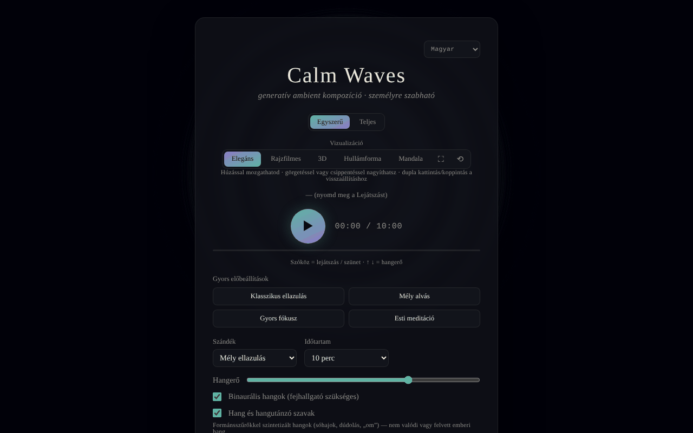

# Calm Waves

[English](README.md) · [Română](README.ro.md) · [Français](README.fr.md) · [Italiano](README.it.md) · [Español](README.es.md) · [Português](README.pt.md) · [Deutsch](README.de.md) · **Magyar**

**Verzió:** 1.2.8 · **Utolsó frissítés:** 2026-10-23

A felület nyelvei: **Română, English, Français, Italiano, Español, Português (PT), Deutsch, Magyar**

Testreszabható generatív ambient kompozíció relaxációhoz, alváshoz, koncentrációhoz és meditációhoz.

**Online alkalmazás:** https://chiuta.github.io/CalmWaves/

## Mi ez

A Calm Waves egy egyfájlos alkalmazás (`index.html`), amely a böngészőben algoritmikusan nyugodt ambient darabokat generál (Web Audio API). Kiválasztod a szándékot, a hangpalettát, a sűrűséget, az időtartamot, a háttértextúrát és a tempót, az alkalmazás pedig egy „variánst” állít elő, amelyet egy kóddal azonosíthatsz, és amelyet másolhatsz és újra betölthetsz. Animált vizualizációkat és hangexportot tartalmaz.

## Funkciók

- Két mód: **Egyszerű** és **Teljes** (utóbbi megjeleníti a haladó vezérlőket).
- Gyors előbeállítások (Klasszikus relaxáció, Mély alvás, Gyors fókusz, Esti meditáció) és egyéni előbeállítások (legfeljebb 12, helyben mentve).
- Paraméterek: szándék (Mély relaxáció, Alvás, Nyugodt koncentráció, Meditáció), hangpaletta (Meleg, Éjszakai, Éteri, Mély), sűrűség (Minimális, Kiegyensúlyozott, Gazdag), időtartam (5–60 perc), háttértextúra (Semleges, Eső, Óceán, Szél), tempó (Lassú, Természetes, Aktív).
- Binaurális ritmusok (fejhallgató szükséges), formánsszűrőkkel szintetizált hang (nem felvett emberi hang) hangprofilokkal, gong az elején és kagylókürt a végén (és kézi 🔔 / 🐚 gombok).
- Folyamatos lejátszás (végtelenül új variánsok) és automatikus leállítás (15–90 perc) a hátralévő idő kijelzésével és a hangerő fokozatos lehalkításával az utolsó 20 másodpercben.
- Hangszínszabályzó (mély/közép/magas) és sztereó szélesség; hangerő.
- Variánskód: másolás (📋), új variáns (🔀), „Betöltés” egy kód lejátszásához; a legutóbbi variánsok előzménye.
- Vizualizációk: Elegáns, Rajzfilm, 3D, Hullám, Mandala; teljes képernyő, nézet visszaállítása, mozgatás/nagyítás egérrel vagy érintéssel.
- Exportálás: WAV, AIFF és „Tömörített exportálás” (WebM/Ogg/M4A, a böngésző támogatásától függően, a MediaRecorder segítségével).
- Lejátszás közben aktívan tartja a képernyőt, ha a böngésző támogatja a Wake Lockot.
- Felület 8 nyelven: English, Română, Français, Italiano, Español, Português, Deutsch, Magyar.
- Magyarázó szakaszok: „Hogyan működik, műszakilag” és „Mit mond valójában a kutatás”.

## Újdonságok (v1.1.0)

- **QR-kód a variánshoz**: a „Variánskód” részből QR készül (webcímmel és `?v=kód` résszel, vagy csak a kóddal, ha nincs webcím); a „QR-kép beolvasása” betölti a variánst; érvénytelen kód vagy QR nélküli kép üzenetet ad, változtatás nélkül.
- **Rövid hangos útmutatás** (opcionális, alapértelmezés szerint kikapcsolva, `FFF.tts`): az elején kimondja a kiválasztott szándékot, a végén egy rövid üzenetet; a munkamenet leállítása elvágja a hangot; ha nincs hang a felület nyelvén, vagy nincs beszédszintézis, egyértelmű üzenet jelenik meg, és semmi sem hangzik el.
- **Beállítható kiolvadás az automatikus leállításkor** (alapértelmezés 20 mp, 1 perc, 5 perc): a hangerő csak a kiválasztott időközben csökken, a tesztekben valós időben ellenőrizve.
- **Kit**: Átláthatóság és `.fff.json` biztonsági mentés (a hangbeállítás indexelt), `core, label, bundle, qr, tts`.
- **Nyelvek és fordítások**: az új szövegek az alkalmazás 8 nyelvén vannak (RO, EN, FR, IT, ES, PT, DE, HU). Az FR/IT/ES/PT/DE/HU fordítások automatikusak, és **anyanyelvi beszélők nem ellenőrizték őket**; a kit párbeszédablaka 8 nyelvű.

## Használati útmutató

1. Válaszd ki a nyelvet a fejléc nyelvválasztójából.
2. Válaszd ki az **Egyszerű** vagy a **Teljes** módot.
3. Válassz egy gyors előbeállítást, vagy állítsd be kézzel a szándékot, a palettát, a sűrűséget, az időtartamot, a textúrát és a tempót.
4. Az indításhoz nyomd meg a ▶ (Meghallgatás) gombot. Billentyűk: **Szóköz** = lejátszás/szünet, **↑ / ↓** = hangerő (±5). A billentyűk nem hatnak, ha a fókusz mezőn, gombon vagy listán van.
5. Váltsd a vizualizációt (Elegáns / Rajzfilm / 3D / Hullám / Mandala); húzással mozgathatsz, görgetéssel vagy csípéssel nagyíthatsz, dupla kattintással visszaállíthatsz.
6. Egy darab újrateremtéséhez másold ki a „Variánskódot” (📋), később illeszd be, és nyomd meg a „Betöltés” gombot. A 🔀 új variánst generál.
7. Saját előbeállításhoz (Teljes mód): írj be egy nevet az „Új előbeállítás neve” mezőbe, és nyomd meg a „+ Jelenlegi előbeállítás hozzáadása” gombot (vagy az Entert).
8. Állítsd be az „Automatikus leállítást”, ha elalváskor hallgatod.
9. Exportálás: „Exportálás WAV-ként”, „AIFF” vagy „Tömörített exportálás” (a „Mégse” gombbal leállítható).

## Adatvédelem és hálózat

- A „trade-free” kit (`fff-kit`, `core, label, bundle, qr, tts` modulok) be van ágyazva az `index.html` fájlba: nem végez hálózati kéréseket. Az „Átláthatóság” párbeszédablak (kattintás a verzióra) megmutatja a deklarált hálózatot (0 külső kérés), a `localStorage` kulcsait, a fájl SHA-256 értékét, és `.fff.json` biztonsági mentést kínál (opcionálisan jelszóval titkosítva, AES-GCM). A QR-kódokat helyben állítja elő és olvassa be; az olvasás kizárólag a felhasználó által kiválasztott képből történik, kamera nélkül.

- **Helyi tárolás:** csak az egyéni előbeállítások, a `localStorage`-ban (`calmWavesCustomPresets` kulcs). A kódban más tartós kulcsot nem találtam.
- **Hálózat:** a kód nem hajt végre `fetch`/XHR hívásokat, és nem tölt be külső szkripteket, betűtípusokat vagy erőforrásokat; a hang és a grafika helyben készül. Az egyetlen külső címek kattintásra megnyíló navigációs hivatkozások: trade-free.org, Buy Me a Coffee (a ♥ gomb).
- Az alkalmazás lábléce kijelenti: MIT, trade-free, 100%-ban offline, telemetria nélkül.

## Korlátok és jogi nyilatkozat

Tájékoztató és relaxációs tartalom; nem orvosi eszköz, és nem helyettesíti az orvosi tanácsot vagy kezelést. A „Mit mond valójában a kutatás” szakasz olyan, tanulmányokról szóló állításokat foglal össze (pl. binaurális ritmusok és szorongás), amelyeket nem ellenőriztek függetlenül (2026. 10. 11-én a webes kereséssel történő ellenőrzés nem vezetett eredményre; az alkalmazás ezt most jelzi egy megjegyzéssel, mind a 8 nyelven), és nem tekinthetők terápiás ígéretnek. Aki epilepsziában vagy neurológiai betegségben szenved, a binaurális ritmusok használata előtt kérje orvos tanácsát. Az oldalnak most szigorú Content-Security-Policy-ja van (`default-src 'none'`, külső kapcsolatok nélkül).

Az alkalmazás lábléce alatt egy rövid megjegyzés (RO/EN) látható.

## Helyi / offline futtatás

Töltsd le az `index.html` fájlt, és nyisd meg egy böngészőben; internet nem szükséges. Néhány funkció a böngészőtől függ (Wake Lock, MediaRecorder a tömörített exportáláshoz).

## Licenc

MIT — lásd a LICENSE fájlt.

## Audit

Audit: 2026-10-10 — a „hálózat nélkül / telemetria nélkül” állítások megfelelnek a kódnak (nincs `fetch`/XHR/CDN).

## Szerző

Alexio — Alexandru-Ionuț Chiuță, elérhetőség: alexio@trom.tf.

## Összefoglaló
A Calm Waves egyfájlos generatív ambient zenei alkalmazás (Web Audio API) szándék, paletta, sűrűség, időtartam, textúra és tempó vezérlőkkel, binaurális hangokkal, szintetizált formáns hangokkal, megosztható variáns-kódokkal, öt vizualizációval, valamint WAV/AIFF/tömörített exporttal. 8 felületi nyelv. Csak az egyéni előbeállítások kerülnek a localStorage-ba; nincsenek hálózati kérések az opcionális kimenő hivatkozásokon kívül. MIT licenc.

## Előzmények / Changelog

- 1.2.8 — 2026-10-23: **fix**: a variant code with a prototype key (e.g. `?v=constructor.…`) or a suffix (`300x`, `5abc`) is now rejected instead of being "loaded" with an empty selection; same for imported custom presets; touch targets ≥ 44 px on touch devices
- 1.2.7 — 2026-10-23: i18n-egyenlőség ellenőrizve: a `sevaLink` kulcs mind a 8 nyelvben megvan (futásidőben egészül ki), kivételként dokumentálva az `fff.config.json`-ban (fff-kit 1.2.0 ellenőrzés)
- 1.2.5 — 2026-10-22: fff-kit 1.1.4: érintési célpontok és minimális szövegméret
- 1.2.4 — 2026-10-22: fff-kit 1.1.2: PBKDF2 600 000 iteráció, clickjacking elleni védelem
- 1.2.3 — 2026-10-22: mobil és kisegítő finomítások: legalább 12 px-es szöveg és legalább 24 px-es érintési felületek.
- **1.2.2 — 2026-10-22:** az aktuális változat kódját tartalmazó mező hozzáférhetőségi címkéje mostantól minden nyelven le van fordítva (korábban románul maradt).
- 1.2.1 — 2026-10-22: **javítás**: a statikus orvosi figyelmeztetés, az ARIA-címkék és a súgószövegek mostantól minden nyelven le vannak fordítva; a magyar felület hiányzó szövegei pótolva (hangos útmutatás, QR, SEVA-hivatkozás).
- 1.1.1 — 2026-10-19: **javítás**: a címben szereplő `?v=<variánskód>` paramétert betöltéskor már nem írja felül az alapértelmezett variáns (a „Variáns betöltve” üzenet hamis volt); tájékoztató hivatkozás a SEVA-ra (alvás, relaxáció, meditáció).
- 1.1.0 — 2026-10-14: QR-kód a variánshoz, hangos útmutatás, beállítható kiolvadás, „trade-free” kit. Tesztek: `tests/fff-r8.test.mjs`.

### 2026. október 12. (v1.0.0)
- 1.0.0 — 2026-10-12: a verzió és az utolsó frissítés dátuma megjelenik az alkalmazásban

### 2026. október 11.
- Az exportálás renderelés közben kijelzi az előrehaladást (százalék); a záró üzenetben szereplő kiterjesztés megfelel a kiválasztott formátumnak. Ha a hang nem indul el (felfüggesztett környezet), ~2,5 mp után látható megjegyzés jelenik meg (7 nyelven).
- Az automatikus leállítás kijelzi a hátralévő időt (7 nyelven), és az utolsó 20 másodpercben fokozatosan csökkenti a hangerőt ahelyett, hogy hirtelen leállna. CSP: `script-src` SHA-256 hash alapján, `'unsafe-inline'` nélkül a szkriptekhez.
- Szigorú Content-Security-Policy (meta) hozzáadva; a WAV/AIFF-exportálás és a lejátszás CSP alatt ellenőrizve.
- A „Mit mond a kutatás” szakasz kifejezett megjegyzést tartalmaz (7 nyelven), hogy az összefoglalót nem ellenőrizték újra függetlenül.
- axe-ellenőrzések (1280 és 360 px): 0 szabálysértés; nincs vízszintes túlcsordulás.

A 2026. 10. 11-én ellenőrzött források: a binaurális ritmusokról és az ultrahangos riasztókról szóló metaanalízisek webes keresése nem hozott meggyőző megerősítést, ezért az állítások továbbra is ellenőrizetlenként vannak megjelölve
