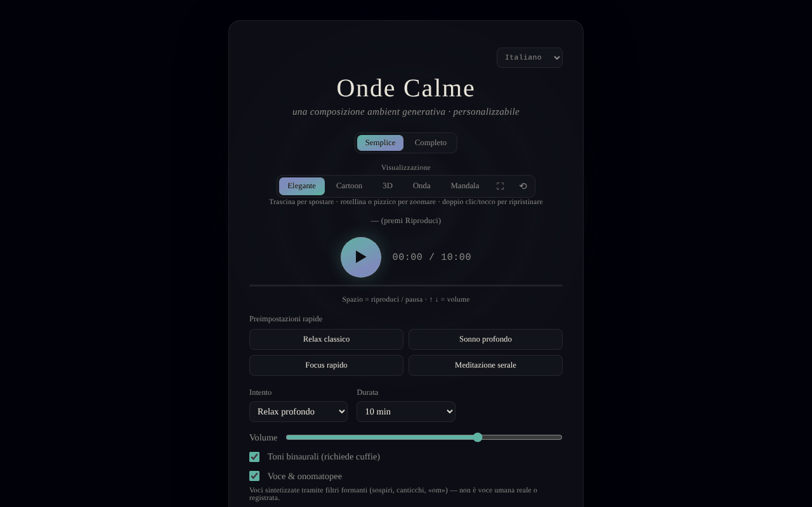

# Calm Waves

[English](README.md) · [Română](README.ro.md) · [Français](README.fr.md) · **Italiano** · [Español](README.es.md) · [Português](README.pt.md) · [Deutsch](README.de.md) · [Magyar](README.hu.md)

**Versione:** 1.2.8 · **Ultimo aggiornamento:** 2026-10-26

Lingue dell'interfaccia: **Română, English, Français, Italiano, Español, Português (PT), Deutsch, Magyar**

Composizione ambient generativa personalizzabile per rilassamento, sonno, concentrazione e meditazione.

**App online:** https://chiuta.github.io/CalmWaves/

## Cos'è

Calm Waves è un'applicazione in un unico file (`index.html`) che genera algoritmicamente, nel browser, brani ambient rilassanti (Web Audio API). Scegli l'intenzione, la tavolozza tonale, la densità, la durata, la texture di fondo e il ritmo, e l'app genera una «variante» identificabile tramite un codice che puoi copiare e ricaricare. Include visualizzazioni animate ed esportazione audio.

## Funzioni

- Due modalità: **Semplice** e **Completa** (quest'ultima mostra i controlli avanzati).
- Preset rapidi (Rilassamento classico, Sonno profondo, Focus rapido, Meditazione serale) e preset personalizzati (massimo 12, salvati localmente).
- Parametri: intenzione (Rilassamento profondo, Sonno, Concentrazione calma, Meditazione), tavolozza tonale (Calda, Notturna, Eterea, Profonda), densità (Minimale, Equilibrata, Ricca), durata (5–60 min), texture di fondo (Neutra, Pioggia, Oceano, Vento), ritmo (Lento, Naturale, Attivo).
- Battiti binaurali (richiedono le cuffie), voce sintetizzata tramite filtri formanti (non una voce umana registrata) con profili vocali, gong all'inizio e conchiglia alla fine (e pulsanti manuali 🔔 / 🐚).
- Riproduzione continua (nuove varianti all'infinito) e spegnimento automatico (15–90 min) con visualizzazione del tempo rimanente e abbassamento graduale del volume negli ultimi 20 s.
- Equalizzatore (bassi/medi/alti) e ampiezza stereo; volume.
- Codice variante: copia (📋), nuova variante (🔀), «Carica» per riprodurre un codice; cronologia delle varianti recenti.
- Visualizzazioni: Elegante, Cartoon, 3D, Onda, Mandala; schermo intero, reimpostazione della vista, spostamento/zoom con mouse o tocco.
- Esportazione: WAV, AIFF e «Esporta compresso» (WebM/Ogg/M4A, a seconda di ciò che il browser supporta, tramite MediaRecorder).
- Mantiene lo schermo attivo durante la riproduzione, se il browser supporta Wake Lock.
- Interfaccia in 8 lingue: English, Română, Français, Italiano, Español, Português, Deutsch, Magyar.
- Sezioni esplicative: «Come funziona, tecnicamente» e «Cosa dice davvero la ricerca».

## Novità (v1.1.0)

- 1.2.4 — 2026-10-22: fff-kit 1.1.2: PBKDF2 600.000 iterazioni, protezione anti-clickjacking
- **Codice QR per la variante**: da «Codice variante» viene generato un QR (con indirizzo web e `?v=codice`, oppure solo il codice se non c'è un indirizzo); «Leggi immagine QR» carica la variante; un codice non valido o un'immagine senza QR produce un messaggio, senza modifiche.
- **Guida vocale breve** (opt-in, disattivata per impostazione predefinita, `FFF.tts`): pronuncia all'inizio l'intenzione scelta e un breve messaggio alla fine; l'interruzione della sessione taglia la voce; senza una voce nella lingua dell'interfaccia o senza sintesi vocale compare un messaggio chiaro e non viene pronunciato nulla.
- **Dissolvenza configurabile allo spegnimento automatico** (20 s predefiniti, 1 min, 5 min): il volume scende solo nell'intervallo scelto, verificato in tempo reale nei test.
- **Kit**: Trasparenza e backup `.fff.json` (la preferenza vocale è indicizzata), `core, label, bundle, qr, tts`.
- **Lingue e traduzioni**: i nuovi testi sono nelle 8 lingue dell'app (RO, EN, FR, IT, ES, PT, DE, HU). Le traduzioni FR/IT/ES/PT/DE/HU sono automatiche e **non verificate da madrelingua**; la finestra di dialogo del kit ha 8 lingue.

## Guida all'uso

1. Scegli la lingua dal selettore di lingua nell'intestazione.
2. Scegli la modalità **Semplice** o **Completa**.
3. Scegli un preset rapido oppure imposta manualmente intenzione, tavolozza, densità, durata, texture e ritmo.
4. Premi ▶ (Ascolta) per avviare. Tasti: **Spazio** = riproduzione/pausa, **↑ / ↓** = volume (±5). I tasti non agiscono quando il focus è su un campo, un pulsante o un elenco.
5. Cambia la visualizzazione (Elegante / Cartoon / 3D / Onda / Mandala); trascina per spostare, scorri o pizzica per lo zoom, doppio clic per reimpostare.
6. Per rifare un brano: copia il «Codice variante» (📋) e in seguito incollalo e premi «Carica». 🔀 genera una nuova variante.
7. Per un preset personale (modalità Completa): scrivi un nome in «Nome del nuovo preset» e premi «+ Aggiungi il preset attuale» (o Invio).
8. Imposta lo «Spegnimento automatico» se ascolti prima di dormire.
9. Esportazione: «Esporta come WAV», «AIFF» o «Esporta compresso» (con «Annulla» per interrompere).

## Privacy e rete

- Il kit «senza frontiere» (`fff-kit`, moduli `core, label, bundle, qr, tts`) è incorporato in `index.html`: non effettua richieste di rete. La finestra «Trasparenza» (clic sulla versione) mostra la rete dichiarata (0 richieste esterne), le chiavi di `localStorage`, lo SHA-256 del file e offre un backup `.fff.json` (facoltativamente cifrato con password, AES-GCM). I codici QR vengono generati e letti localmente; la lettura avviene solo da un'immagine scelta dall'utente, senza fotocamera.

- **Archiviazione locale:** solo i preset personalizzati, in `localStorage` (chiave `calmWavesCustomPresets`). Nel codice non ho trovato altre chiavi persistenti.
- **Rete:** il codice non effettua chiamate `fetch`/XHR e non carica script, font o risorse esterne; audio e grafica sono generati localmente. Gli unici indirizzi esterni sono link di navigazione aperti al clic: trade-free.org, Buy Me a Coffee (il pulsante ♥).
- Il piè di pagina dell'app dichiara: MIT, trade-free, 100% offline, senza telemetria.

## Limiti e avvertenza

Contenuto informativo e di relax; non è un dispositivo medico e non sostituisce il parere medico né le cure. La sezione «Cosa dice davvero la ricerca» riassume affermazioni su studi (ad es. battiti binaurali e ansia) che non sono state verificate in modo indipendente (all'11.10.2026 la verifica tramite ricerca web è rimasta inconcludente; l'app ora mostra una nota in tal senso, in tutte e 8 le lingue) e non vanno intese come una promessa terapeutica. Chi soffre di epilessia o di disturbi neurologici dovrebbe chiedere il parere di un medico prima di usare i battiti binaurali. La pagina ha ora una Content-Security-Policy rigorosa (`default-src 'none'`, senza connessioni esterne).

Una breve nota (RO/EN) è mostrata sotto il piè di pagina dell'app.

## Esecuzione locale / offline

Scarica `index.html` e aprilo in un browser; non serve Internet. Alcune funzioni dipendono dal browser (Wake Lock, MediaRecorder per l'esportazione compressa).

## Licenza

MIT — vedi il file LICENSE.

## Audit

Audit: 2026-10-10 — le affermazioni «senza rete / senza telemetria» corrispondono al codice (nessun `fetch`/XHR/CDN).

## Autore

Alexio — Alexandru-Ionuț Chiuță, contatto: alexio@trom.tf.

## Riepilogo

Calm Waves è un'app di musica ambient generativa in un unico file (Web Audio API) con controlli di intenzione, tavolozza, densità, durata, texture e ritmo, toni binaurali, voci a formanti sintetizzate, codici di variante condivisibili, cinque visualizzazioni ed esportazione in WAV/AIFF/formato compresso. 8 lingue dell'interfaccia. Solo i preset personalizzati sono salvati in localStorage; nessuna richiesta di rete oltre ai link in uscita facoltativi. Licenza MIT.

## Cronologia / Changelog

- 1.2.7 — 2026-10-23: Parità i18n verificata: la chiave `sevaLink` esiste in tutte le 8 lingue (completata a runtime), documentata come eccezione in `fff.config.json` (controllo fff-kit 1.2.0)
- 1.2.5 — 2026-10-22: fff-kit 1.1.4: target touch e dimensione minima del testo
- 1.2.3 — 2026-10-22: rifiniture per mobile e accessibilità: testo di almeno 12 px e aree tattili di almeno 24 px.
- **1.2.2 — 2026-10-22:** l'etichetta di accessibilità del campo del codice della variante corrente è ora tradotta in tutte le lingue (era rimasta in rumeno).
- 1.2.1 — 2026-10-22: **correzione**: l’avviso medico statico, le etichette ARIA e i tooltip sono ora tradotti in tutte le lingue; completate le stringhe dell’interfaccia in ungherese (guida vocale, QR, link SEVA).
- 1.1.1 — 2026-10-19: **correzione**: il parametro `?v=<codice variante>` dell'indirizzo non viene più sovrascritto dalla variante predefinita al caricamento (il messaggio «Variante caricata» era falso); link informativo a SEVA (sonno, relax, meditazione).
- 1.1.0 — 2026-10-14: codice QR per la variante, guida vocale, dissolvenza configurabile, kit «senza frontiere». Test: `tests/fff-r8.test.mjs`.

### 12 ottobre 2026 (v1.0.0)
- 1.0.0 — 2026-10-12: la versione e la data dell'ultimo aggiornamento sono mostrate nell'app

### 11 ottobre 2026
- L'esportazione mostra l'avanzamento (percentuale) durante il rendering; l'estensione nel messaggio finale corrisponde al formato scelto. Se l'audio non parte (contesto sospeso), dopo ~2,5 s compare una nota visibile (7 lingue).
- Lo spegnimento automatico mostra il tempo rimanente (7 lingue) e abbassa il volume gradualmente negli ultimi 20 s, invece di fermarsi bruscamente. CSP: `script-src` su hash SHA-256, senza `'unsafe-inline'` per gli script.
- Aggiunta una Content-Security-Policy (meta) restrittiva; esportazione WAV/AIFF e riproduzione verificate sotto CSP.
- La sezione «Cosa dice la ricerca» ha una nota esplicita (7 lingue) che il riepilogo non è stato riverificato in modo indipendente.
- Verifiche axe (1280 e 360 px): 0 violazioni; nessun overflow orizzontale.

Fonti verificate all'11.10.2026: la ricerca web di metanalisi sui battiti binaurali e sui repellenti a ultrasuoni non ha dato conferme conclusive, per questo le affermazioni restano contrassegnate come non verificate
