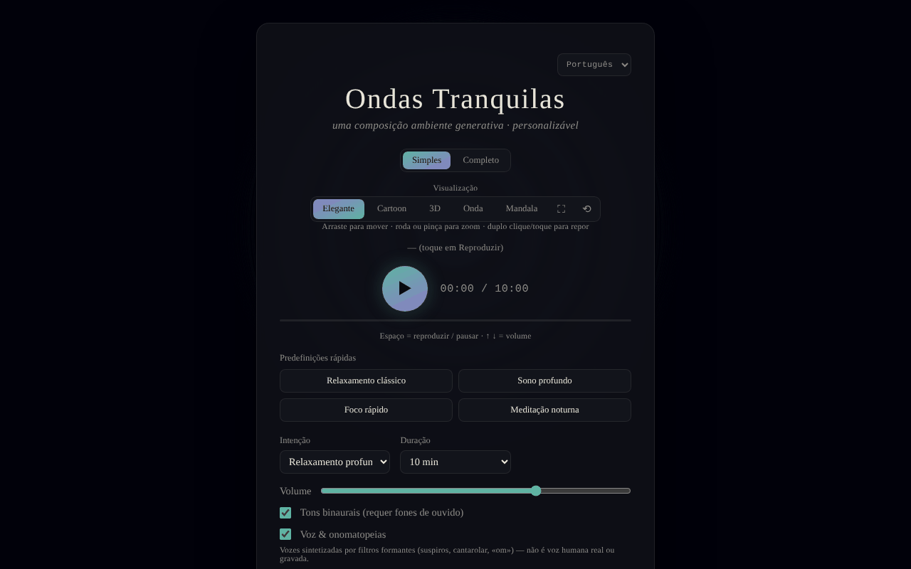

# Calm Waves

[English](README.md) · [Română](README.ro.md) · [Français](README.fr.md) · [Italiano](README.it.md) · [Español](README.es.md) · **Português** · [Deutsch](README.de.md) · [Magyar](README.hu.md)

**Versão:** 1.2.7 · **Última atualização:** 2026-10-23

Idiomas da interface: **Română, English, Français, Italiano, Español, Português (PT), Deutsch, Magyar**

Composição ambiente generativa personalizável para relaxamento, sono, concentração e meditação.

**Aplicação online:** https://chiuta.github.io/CalmWaves/

## O que é

O Calm Waves é uma aplicação de um único ficheiro (`index.html`) que gera algoritmicamente, no navegador, peças ambiente tranquilas (Web Audio API). Escolhes a intenção, a paleta tonal, a densidade, a duração, a textura de fundo e o ritmo, e a aplicação gera uma «variante» identificável através de um código que podes copiar e voltar a carregar. Inclui visualizações animadas e exportação de áudio.

## Funcionalidades

- Dois modos: **Simples** e **Completo** (este último mostra os controlos avançados).
- Predefinições rápidas (Relaxamento clássico, Sono profundo, Foco rápido, Meditação vespertina) e predefinições personalizadas (máximo de 12, guardadas localmente).
- Parâmetros: intenção (Relaxamento profundo, Sono, Concentração calma, Meditação), paleta tonal (Quente, Noturna, Etérea, Profunda), densidade (Mínima, Equilibrada, Rica), duração (5–60 min), textura de fundo (Neutra, Chuva, Oceano, Vento), ritmo (Lento, Natural, Ativo).
- Batimentos binaurais (requerem auscultadores), voz sintetizada através de filtros de formantes (não é uma voz humana gravada) com perfis de voz, gongo no início e concha no fim (e botões manuais 🔔 / 🐚).
- Reprodução contínua (novas variantes sem fim) e paragem automática (15–90 min) com o tempo restante visível e descida gradual do volume nos últimos 20 s.
- Equalizador (graves/médios/agudos) e largura estéreo; volume.
- Código de variante: copiar (📋), nova variante (🔀), «Carregar» para reproduzir um código; histórico de variantes recentes.
- Visualizações: Elegante, Cartoon, 3D, Onda, Mandala; ecrã inteiro, repor a vista, deslocação/zoom com o rato ou com toque.
- Exportação: WAV, AIFF e «Exportar comprimido» (WebM/Ogg/M4A, consoante o que o navegador suporta, através de MediaRecorder).
- Mantém o ecrã ativo durante a reprodução, se o navegador suportar Wake Lock.
- Interface em 8 línguas: English, Română, Français, Italiano, Español, Português, Deutsch, Magyar.
- Secções explicativas: «Como funciona, tecnicamente» e «O que diz realmente a investigação».

## Novidades (v1.1.0)

- **Código QR da variante**: a partir de «Código de variante» é gerado um QR (com endereço web e `?v=código`, ou apenas o código se não houver endereço); «Ler imagem QR» carrega a variante; um código inválido ou uma imagem sem QR dá uma mensagem, sem alterações.
- **Orientação por voz breve** (opcional, desativada por predefinição, `FFF.tts`): diz no início a intenção escolhida e uma mensagem curta no fim; parar a sessão corta a voz; sem voz na língua da interface ou sem síntese de voz aparece uma mensagem clara e nada é dito.
- **Esbatimento configurável na paragem automática** (20 s por predefinição, 1 min, 5 min): o volume desce apenas no intervalo escolhido, verificado em tempo real nos testes.
- **Kit**: Transparência e cópia de segurança `.fff.json` (a preferência de voz é indexada), `core, label, bundle, qr, tts`.
- **Línguas e traduções**: os textos novos estão nas 8 línguas da aplicação (RO, EN, FR, IT, ES, PT, DE, HU). As traduções FR/IT/ES/PT/DE/HU são automáticas e **não foram verificadas por falantes nativos**; a caixa de diálogo do kit tem 8 línguas.

## Guia de utilização

1. Escolhe a língua no seletor de língua do cabeçalho.
2. Escolhe o modo **Simples** ou **Completo**.
3. Escolhe uma predefinição rápida ou define manualmente a intenção, a paleta, a densidade, a duração, a textura e o ritmo.
4. Prime ▶ (Ouvir) para começar. Teclas: **Espaço** = reproduzir/pausa, **↑ / ↓** = volume (±5). As teclas não atuam quando o foco está num campo, botão ou lista.
5. Muda a visualização (Elegante / Cartoon / 3D / Onda / Mandala); arrasta para mover, roda ou pinça para zoom, duplo clique para repor.
6. Para refazer uma peça: copia o «Código de variante» (📋) e mais tarde cola-o e prime «Carregar». 🔀 gera uma nova variante.
7. Para uma predefinição própria (modo Completo): escreve um nome em «Nome da nova predefinição» e prime «+ Adicionar a predefinição atual» (ou Enter).
8. Define a «Paragem automática» se ouves ao deitar.
9. Exportação: «Exportar como WAV», «AIFF» ou «Exportar comprimido» (com «Cancelar» para parar).

## Privacidade e rede

- O kit «sem fronteiras» (`fff-kit`, módulos `core, label, bundle, qr, tts`) está integrado em `index.html`: não faz pedidos de rede. A caixa de diálogo «Transparência» (clique na versão) mostra a rede declarada (0 pedidos externos), as chaves do `localStorage`, o SHA-256 do ficheiro e oferece uma cópia de segurança `.fff.json` (opcionalmente cifrada com palavra-passe, AES-GCM). Os códigos QR são gerados e lidos localmente; a leitura faz-se apenas a partir de uma imagem escolhida pelo utilizador, sem câmara.

- **Armazenamento local:** apenas as predefinições personalizadas, no `localStorage` (chave `calmWavesCustomPresets`). Não encontrei outras chaves persistentes no código.
- **Rede:** o código não faz chamadas `fetch`/XHR e não carrega scripts, tipos de letra ou recursos externos; o áudio e os gráficos são gerados localmente. Os únicos endereços externos são ligações de navegação abertas ao clicar: trade-free.org, Buy Me a Coffee (o botão ♥).
- O rodapé da aplicação declara: MIT, trade-free, 100% offline, sem telemetria.

## Limitações e aviso legal

Conteúdo informativo e de relaxamento; não é um dispositivo médico e não substitui o aconselhamento médico nem o tratamento. A secção «O que diz realmente a investigação» resume afirmações sobre estudos (p. ex., batimentos binaurais e ansiedade) que não foram verificadas de forma independente (a 11.10.2026 a verificação por pesquisa na web ficou inconclusiva; a aplicação apresenta agora uma nota nesse sentido, nas 8 línguas) e não devem ser tomadas como uma promessa terapêutica. Quem tem epilepsia ou afeções neurológicas deve pedir o conselho de um médico antes de usar batimentos binaurais. A página tem agora uma Content-Security-Policy rigorosa (`default-src 'none'`, sem ligações externas).

Uma nota curta (RO/EN) é apresentada por baixo do rodapé da aplicação.

## Execução local / offline

Descarrega `index.html` e abre-o num navegador; não requer internet. Algumas funcionalidades dependem do navegador (Wake Lock, MediaRecorder para a exportação comprimida).

## Licença

MIT — ver o ficheiro LICENSE.

## Auditoria

Auditoria: 2026-10-10 — as afirmações «sem rede / sem telemetria» correspondem ao código (sem `fetch`/XHR/CDN).

## Autor

Alexio — Alexandru-Ionuț Chiuță, contacto: alexio@trom.tf.

## Resumo

O Calm Waves é uma aplicação de música ambiente generativa num único ficheiro (Web Audio API), com controlos de intenção, paleta, densidade, duração, textura e ritmo, tons binaurais, vozes de formantes sintetizadas, códigos de variantes partilháveis, cinco visualizações e exportação WAV/AIFF/comprimida. 8 idiomas de interface. Apenas as predefinições personalizadas são guardadas em localStorage; sem pedidos de rede além de ligações externas opcionais. Licença MIT.

## Histórico / Changelog

- 1.2.7 — 2026-10-23: Paridade i18n verificada: a chave `sevaLink` existe nos 8 idiomas (preenchida em execução), documentada como exceção em `fff.config.json` (verificação fff-kit 1.2.0)
- 1.2.5 — 2026-10-22: fff-kit 1.1.4: alvos de toque e tamanho mínimo do texto
- 1.2.4 — 2026-10-22: fff-kit 1.1.2: PBKDF2 600 000 iterações, proteção anti-clickjacking
- 1.2.3 — 2026-10-22: melhorias para telemóvel e acessibilidade: texto de pelo menos 12 px e áreas táteis de pelo menos 24 px.
- **1.2.2 — 2026-10-22:** a etiqueta de acessibilidade do campo do código da variante atual está agora traduzida em todos os idiomas (estava em romeno).
- 1.2.1 — 2026-10-22: **correção**: o aviso médico estático, os rótulos ARIA e as dicas já estão traduzidos em todos os idiomas; cadeias de interface em húngaro completadas (orientação vocal, QR, ligação ao SEVA).
- 1.1.1 — 2026-10-19: **correção**: o parâmetro `?v=<código de variante>` do endereço deixa de ser substituído pela variante predefinida ao carregar (a mensagem «Variante carregada» era falsa); ligação informativa para o SEVA (sono, relaxamento, meditação).
- 1.1.0 — 2026-10-14: código QR da variante, orientação por voz, esbatimento configurável, kit «sem fronteiras». Testes: `tests/fff-r8.test.mjs`.

### 12 de outubro de 2026 (v1.0.0)
- 1.0.0 — 2026-10-12: a versão e a data da última atualização são apresentadas na aplicação

### 11 de outubro de 2026
- A exportação mostra o progresso (percentagem) durante a renderização; a extensão na mensagem final corresponde ao formato escolhido. Se o áudio não arrancar (contexto suspenso), surge uma nota visível (7 línguas) ao fim de ~2,5 s.
- A paragem automática mostra o tempo restante (7 línguas) e baixa o volume gradualmente nos últimos 20 s, em vez de parar abruptamente. CSP: `script-src` com hash SHA-256, sem `'unsafe-inline'` para os scripts.
- Adicionada uma Content-Security-Policy (meta) restritiva; exportação WAV/AIFF e reprodução verificadas sob CSP.
- A secção «O que diz a investigação» tem uma nota explícita (7 línguas) de que o resumo não foi reverificado de forma independente.
- Verificações axe (1280 e 360 px): 0 violações; sem excesso horizontal.

Fontes verificadas a 11.10.2026: a pesquisa na web de meta-análises sobre batimentos binaurais e sobre repelentes de ultrassons não deu confirmações conclusivas, pelo que as afirmações continuam assinaladas como não verificadas
